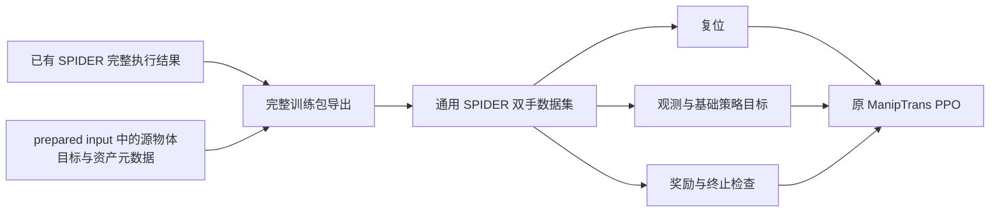

# SPIDER 参考接入 ManipTrans 双手训练：修改方案与交接说明

日期：2026-10-20。状态：**方案文档，以下新增接口和命令尚未实现**。

这份文档供另一个窗口直接执行修改。目标是让原生 SPIDER 生成的 OakInk2/TACO
完整参考成为 ManipTrans 训练实际使用的手部目标，并保持原有训练模式可用。
本轮只编写此文档，没有据此修改导出器、训练器或 PPO。

## 1. 当前结论与已核实的问题

**当前输出已兼容 ManipTrans 的 retarget PKL 文件格式，但尚不能沿用原训练命令，
就自动完成以 SPIDER 为手部参考的训练。**

已有正式 PKL 的内容如下；两手都已通过真实 `ManipData.load_retargeted_data` 回读：

| 字段 | Artimano 形状 | 含义 |
| --- | --- | --- |
| `opt_wrist_pos` | `[T,3]` | 实际执行的机器人腕部世界位置，米 |
| `opt_wrist_rot` | `[T,3]` | 机器人腕部轴角，弧度 |
| `opt_dof_pos` | `[T,22]` | 实际执行的关节角，不是控制目标 |
| `opt_joints_pos` | `[T,28,3]` | 含 palm 的机器人 link 世界位置 |
| `spider_metadata` | 字典 | 帧率、资产、关节顺序、质量状态等 |

目前具体缺口：

| 位置（相对下游仓库） | 当前行为 | 需要解决的问题 |
| --- | --- | --- |
| `main/dataset/oakink2_dataset_dexhand_{rh,lh}.py` | 固定读取 `support_root/retargeting/OakInk-v2/...` | 不会自动读取新生成的参考目录 |
| `main/dataset/base.py::load_retargeted_data` | 读取三个 `opt_*` 字段，`opt_joints_pos` 的读取被注释 | 机器人全 link 参考没有进入训练目标 |
| `main/dataset/factory.py::dataset_type` | 普通字符串默认路由到 `hotracker` | 不能靠 `sk_box_1104218` 自动选择 TACO |
| `main/dataset/` | 没有 TACO 数据集类 | 原始 TACO 数据还不能直接由当前训练数据工厂加载 |
| `dexhandmanip_bih.py::_reset_default_side` | 用 `opt_wrist_* / opt_dof_*` 复位 | 替换 PKL 主要改变初始化 |
| 同文件 `compute_reward_side` | 用 `wrist_pos / wrist_rot / mano_joints` 及其速度 | 奖励仍可能跟踪原始人手参考 |
| 同文件 `compute_observations_side` | 未来目标也读取上述原始字段 | 观测、奖励与复位的参考可能混用 |
| 同文件 `pack_data` | 按 `to_hand()` 把人手关节重复映射到机器人 link | 不能将真实 28 个机器人 link 再按人手映射处理 |
| `main/cfg/task/ResDexHand.yaml` | 默认 `episodeLength: 1200` | 会截断已有 1294 帧 OakInk2 参考 |

当前双手 PPO 入口是 `main/rl/train.py`，任务配置为 `task=ResDexHand side=BiH`，
实际环境是 `DexHandManipBiHEnv`。`DexManipNet/dexmanip_bih.py` 是单环境可视化
工具，不是需要优先修改的训练入口。

“通过回读”不等于已验证 PPO 启动或收敛。当前完整实测结果包括：

- OakInk2：`9fc3e@0 + kni@1`，1294 帧，两手各 22 DOF。
- TACO：`sk_box_1104218 + 045`，259 帧，两手各 22 DOF。
- 两者质量状态均为失败，但已按用户要求导出完整正式 PKL。
- `sk_box_1104218 + 153` 已完成输入准备；不能据此声称 153 的完整优化已经完成。

## 2. 修改位置、边界与推荐路线

当前核对的仓库根目录：

```text
生成端 A：/home/user/ylj/spider_repro/spider
训练端 B：/home/user/ylj/spider_repro/HO-Tracker-Baseline
```

如在另一份 ManipTrans/PhysGraph 分支中修改，先核对同名模块和实际任务注册；
以下路径与行为以 B 当前代码为准，不代表其他分支已经具备同样功能。

推荐采用：**兼容 PKL 保留，增加独立完整训练包，训练端增加通用 SPIDER 数据集
适配器**。适配器直接消费已生成结果，因此不需要先在 B 中重新实现完整 TACO
原始数据读取、MANO 重建和 30→60 Hz 插值。



实施要求：

1. 新模式显式启用，原模式默认保持 `referenceSource=legacy`。不覆盖原始
   `data/retargeting`，也不通过全局软链接把原始参考替换掉。
2. SPIDER 模式手部的复位、观测和奖励使用同一组 SPIDER 机器人参考。
3. 原始任务物体目标默认保持原示范，供对比实验使用；详见第 4 节。
4. 用户已明确允许质量验证失败的完整轨迹参与训练。质量失败须保留，不能又以
   `status=failed` 为由在训练加载阶段拒绝；格式错误、缺帧、非有限值仍须拒绝。
5. 不改 PPO 损失、动作含义或网络结构；先完成参考接口与实际训练接入。
6. 使用现有 Python 3.8 ManipTrans 环境训练，不将原生 Python 3.11/MuJoCo/Warp
   依赖引入训练进程，也不自动升级原训练环境。

仅把 PKL 路径改掉可以实现“替换 retarget 初始化”，但达不到本方案的完整手部
参考目标。这一点必须在实现与验收时区分。

## 3. 利用已有轨迹增加完整训练包

### 3.1 新增独立打包器

建议新增 A 中的：

```text
spider/postprocess/export_maniptrans_training.py
```

设计 CLI：

```bash
# 以下是待实现的接口，当前尚不存在该模块。
python -m spider.postprocess.export_maniptrans_training \
  --generation-json /absolute/path/to/generation.json \
  --output-root /absolute/path/to/retargeting_spider_native
```

打包时使用 `generation.json` 的：

- `reference_export_source`：本次正式参考实际选用的完整状态 NPZ。可能是独立
  重放，也可能是完整原生执行，不能擅自改选其他来源。
- `prepared_input`：已对齐到参考帧率、已处于模拟世界坐标的源物体目标。
- `exported_references`：现有两手 PKL，可用于一致性核对。
- 资产、DOF/link 名称、质量状态、坐标矩阵等元数据。

不要把 `prepared_input` 中原始初始化的手部姿态当成 SPIDER 优化后的手部轨迹。
只有其中的源物体目标和相关元数据用于新包的原始任务目标。

打包器只依赖 NumPy/SciPy 与标准库即可；不依赖 IsaacGym、Torch 或 Warp。
现有正式 PKL 的字段与路径继续保留。新包增加在：

```text
<output_root>/<tool-or-original>/<dataset>/training/<task>/
  manifest.json
  trajectory.npz
```

例如：

```text
data/retargeting_spider_native/045/TACO/training/sk_box_1104218/
data/retargeting_spider_native/kni@1/OakInk-v2/training/9fc3e@0/
```

`task` 与原始 PKL 文件名不是同一概念。OakInk2 的 `9fc3e@0` 对应的是完整
`scene_...@0.pkl` 文件名，必须使用已有元数据记录，不能猜测为 `9fc3e@0.pkl`。
TACO 原始短任务名对应 `sk_box_1104218.pkl`；若使用完整序列名生成，应记录任务
别名，不能通过不唯一的前缀搜索选择另一个任务。

### 3.2 训练包契约

`manifest.json` 至少保存：

```text
schema_version = 1
source_dataset = OakInk-v2 | TACO
task / task_aliases / reference_filename / new_obj
robot_type = artimano
fps = 60.0
recorded_frames / expected_frames / complete
frame_coordinates = maniptrans_world
rotation_convention = rotvec; state_quaternion = xyzw
state_source / method / reference_kind
source_to_simulation / source_alignment（如存在）
validation_status / failed_at / failure_reason / optimizer_fallbacks
physical_replay / allow_validation_failure
trajectory_file = trajectory.npz
rh/lh:
  dof_names / body_names / hand_urdf
  source_object_id / selected_asset_id
  obj_mesh_path / obj_urdf_path / object_scale / object_mass_override
```

应记录手部 URDF 的校验值；至少核对导出与训练使用相同的手型、link 定义和
关节名。资产路径支持绝对路径，或相对 manifest/显式资产根目录的路径。
移动仓库后可显式重映射资产根目录；路径失效应报错，不应随机搜索同名网格。

`trajectory.npz` 至少包含以下无 pickle 数值数组：

| 数组 | 形状 | 来源 |
| --- | --- | --- |
| `frame_index` | `[T]` | `0..T-1` |
| `time_seconds` | `[T]` | `frame_index / fps` |
| `{rh,lh}_wrist_pos` | `[T,3]` | 正式执行状态/PKL |
| `{rh,lh}_wrist_rotvec` | `[T,3]` | 正式执行状态/PKL |
| `{rh,lh}_dof_pos` | `[T,22]` | 正式执行状态/PKL |
| `{rh,lh}_joint_pos` | `[T,28,3]` | 正式执行状态/PKL，包含 palm |
| `{rh,lh}_source_object_transform` | `[T,4,4]` | `prepared_input` 的对应 `object_transform` |
| `{rh,lh}_sim_object_state` | `[T,13]` | 正式执行状态，供显式选择/诊断 |

要求两手、物体与时间轴严格同长。先验证所有内容，再原子写入新包，避免只写完
右手就把半成品呈现为完整训练包。不得用重复末帧填补缺失的真实执行帧。

不要把日志中的 `native_controls` 写成策略动作：它们是 120 Hz 的位置目标，
长度与 60 Hz 状态也不同，不能直接替代 ManipTrans 的基础策略/残差动作。

### 3.3 现有结果无需重新优化

可先利用这两个已存在的报告实现和验收打包器：

```text
A/example_datasets/validation/native_taco_sk_box_045/generation.json
A/example_datasets/validation/native_9fc3e_kni1_relaxed/generation.json
```

其中 `A/` 是第 2 节定义的生成仓库根目录，不是实际目录名。
两个报告都指向完整结果、源输入和双手正式 PKL，足够生成训练包。

再将打包器接到 A 的 `spider/native_generation.py`：完整正式参考导出后调用它，
建议增加 `export_training_bundle=true` 配置及 `training_bundle` 报告字段。
保持 `strict_validation=false` 的原有语义，不能因为重放质量失败而阻断新包。
本配置项目前尚不存在，应在实现时同时声明到原生 YAML 配置。

## 4. 明确物体目标，避免改变对比任务

推荐新增 `objectReference`，默认 `demonstration`：

| 策略 | 物体复位、观测与奖励共同使用的目标 | 用途 |
| --- | --- | --- |
| `demonstration` | 包内 `source_object_transform` | 默认对比实验，保留原任务目标 |
| `spider_rollout` | 包内 `sim_object_state` 转换出的变换 | 显式的完整模拟轨迹跟踪消融 |

**不能默认用质量失败后物体掉落的模拟轨迹，替换原任务的成功目标。**
否则参考可能更容易跟踪，但对比实验的任务已经改变。

同一次实验中该选择应固定、写入训练日志，并同时用于物体复位、观测、奖励、
成功/失败判断和速度计算。手部始终使用 SPIDER 参考。
在 `demonstration` 模式下，质量失败的 SPIDER 手部与原物体目标可能不再接触，
这是输入参考的质量问题，应报告，不应通过混用两个物体目标掩盖。

## 5. 训练端新增通用 SPIDER 数据集

建议新增 B 的：

```text
main/dataset/spider_reference.py
```

使用当前数据工厂的注册装饰器注册 `spider_rh`、`spider_lh`，共享包读取和验证
逻辑。训练中显式 `datasetType=spider`，无需修改 `dataset_type()` 对旧索引的
路由规则，也不要求先实现原始 TACO 数据集类。

### 5.1 加载和资产

1. `__getitem__(task)` 定位 `<root>/<tool>/<dataset>/training/<task>/manifest.json`，
   或按显式记录的别名定位；校验两手是同一次生成、同一任务和同一时间轴。
2. 只加载该模式的 SPIDER 包。文件缺失时禁止回退到旧 retarget、零 DOF 或
   原始人手目标；旧模式现有的 fallback 不必全局修改。
3. 依据训练手型的 `dof_names/body_names` 按名字重排数组。名称必须唯一、集合
   一致；不能仅凭“都是 22 维/28 个 link”认定顺序兼容。
4. 所有 NumPy 数值在加载阶段转换为指定设备上的 `torch.float32`；保持轨迹只读，
   缓存键包含路径、任务、工具、物体目标策略等，避免不同工具共用旧数据。
5. 点云、碰撞 URDF、BPS 都来自实际选择的工具。保持 `obj_id` 为源身份，另设
   `selected_asset_id`，不能为方便查网格而将源任务身份改写成新工具编号。
6. 例如 TACO `newObj=153`：右手源身份 `205`、实际资产 `153`；左手源身份和
   实际资产仍为 `143`。两手包都位于 `153/TACO/` 命名空间，但左手不能加载 153。
7. 显式核对密度、摩擦、物体缩放及质量覆盖。缩放需在点云和物理 actor 中一致，
   不能只缩放碰撞 actor；不能重复缩放已经是米的 TACO PLY。

当前 `_create_obj_assets()` 已用源身份和 URDF 路径区分资产缓存，并读取
`selected_asset_id` 决定缩放/质量。优先复用，核对实际资产路径及 scale，不回退
成“仅按源身份缓存所有工具”。

### 5.2 坐标与时间轴

- 新包的手、物体和 link 坐标均已在 ManipTrans 世界坐标。不要再次调用原始
  `process_data()` 的坐标转换，也不要第二次叠加 `source_to_simulation`。
- OakInk2 使用生成时记录的旋转和平移。TACO 使用生成时记录的共同平移注册；
  下游不得重新估计另一份平移，必须沿用包内结果及配准误差说明。
- 已有 TACO 包是 259 帧、60 Hz；不要再 `skip=2` 或二次插值。可设置适配器的
  `dataset_fps=60, skip=1`，确保所有速度计算的有效间隔为 `1/60`。
- 检查控制时钟 `sim.dt * controlFrequencyInv` 与参考时钟一致；物理 substeps
  不是参考跳帧。若确需异频，必须实现并验证统一的参考索引策略。
- 构造数据时不得按 `max_seq_len=1200` 静默裁剪完整 OakInk2 参考。配置过短应
  提示提高 `episodeLength`，或在明确的窗口训练模式中记录窗口范围。

### 5.3 形成统一的训练字段

下表中的变量都来自选定 SPIDER 包；对同名字段的赋值必须在生成速度前完成。

| 下游字段 | SPIDER 模式来源 |
| --- | --- |
| `opt_wrist_pos`、`wrist_pos` | 同一份执行腕部位置 |
| `opt_wrist_rot`、`wrist_rot` | 同一份执行腕部轴角 |
| `opt_dof_pos` | 执行关节角，按训练 DOF 顺序 |
| `reference_joint_pos` | 执行 link 位置，按训练 body 顺序，包含 palm |
| `obj_trajectory` | 按第 4 节选择的物体变换 |
| `wrist_velocity`、`opt_wrist_velocity` | 同一时间轴、同一算法的腕部线速度 |
| `wrist_angular_velocity`、`opt_wrist_angular_velocity` | 同一时间轴、同一算法的腕部角速度 |
| `opt_dof_velocity` | 执行关节角的时间导数 |
| `reference_joint_velocity` | 执行 link 位置的时间导数 |
| `obj_velocity`、`obj_angular_velocity` | 选定物体目标的速度 |
| `tips_distance` | 新机器人指尖与实际工具/目标物体之间的距离 |
| `obj_mesh_path / obj_urdf_path / obj_verts / selected_asset_id` | 包中实际选择的资产 |

速度建议复用 `ManipData.compute_velocity/compute_angular_velocity/compute_dof_velocity`
及其 Gaussian 策略，所有相关字段一致处理，不混用原始人手速度和新机器人位置。
角速度通过相邻旋转矩阵计算，不能直接对跨 ±π 的轴角向量做差分。
若选择直接使用 MuJoCo 状态速度，则必须统一相关字段并显式记录策略，不能只
替换一个 `opt_*` 字段而让其余目标仍用旧导数。

`tips_distance` 的五指顺序为 `thumb,index,middle,ring,pinky`。按实际 body 名找到
机器人 tip 位置，用选定物体的位姿及对应缩放后的点云重新计算。不能继续沿用
原人手与源工具的接触距离，否则接触奖励与目标几何不一致。

## 6. 修正 pack_data 的机器人 link 目标分支

Artimano 的多个机器人 link 会映射到同一个人手 `*_proximal` 名称。例如
`index1y/index1z` 都对应 `index_proximal`。因此：

**不能把 28 个真实机器人 link 位置塞进旧的 `mano_joints` 字典，再用旧映射打包。**
这会合并原本不同的机器人位置，维度可能对得上，目标却已经错误。

给 B 的 `dexhandmanip_bih.py::pack_data()` 增加 SPIDER 专用分支，原分支保留。
用机器人名字重排后直接构造现有网络所需的兼容字段：

```python
# 伪代码：data[i] 为一条样本，world_link_pos 已按当前 dexhand.body_names 排序。
world_link_pos = data[i]["reference_joint_pos"]       # [T,28,3]
world_link_vel = data[i]["reference_joint_velocity"]  # [T,28,3]
assert dexhand.body_names[0] == "palm"

# 仅保留现有接口字段名，内容明确是机器人 link 参考。
mano_compat_pos = world_link_pos[:, 1:].reshape(T, -1)  # [T,81]
mano_compat_vel = world_link_vel[:, 1:].reshape(T, -1)  # [T,81]
packed_data["mano_joints"] = stack_and_pad(mano_compat_pos)
packed_data["mano_joints_velocity"] = stack_and_pad(mano_compat_vel)
```

这样 `compute_reward_side()` 中的 `[B,27,3]` 目标可与
`states["joints_state"][:,1:,:3]` 一一对应，未来目标维度也保持原结构。
为避免混淆，保留 `reference_source=spider` 元数据，注释说明 `mano_joints` 在该
分支只是兼容字段名。也可内部改为明确的 robot 字段，但对外网络顺序和维数不变。

批量不同长度序列的张量 padding 可以复用现有机制，但必须保留真实 `seq_len`，
所有索引和结束判断用真实长度。批量 padding 不能被当成源轨迹真实补帧或完整性
证明。新分支不要影响原人手字典的打包规则。

## 7. 串联环境、目标与边界

修改 B 的 `maniptrans_envs/lib/envs/tasks/dexhandmanip_bih.py`：

1. `_create_envs()` 的数据工厂构造处：`referenceSource=spider` 时分别创建
   `spider_rh/spider_lh`，传入参考根目录、数据集、工具、物体目标策略及质量策略。
   不再只通过当前 `oakinkDataDir` 条件分支传参数。
2. SPIDER 模式数据必须在 `pack_data()` 前完成全部字段准备。两手共用帧索引，
   校验同一任务和同一选定物体目标策略。
3. `_reset_default_side()`：使用上述同源 `opt_*` 与 `obj_trajectory`。可保留
   执行时物理限位保护；对于大幅越限的参考记录差异，不能静默改写整份参考再
   将其标为原 SPIDER 输出。
4. `compute_observations_side()` 与 `compute_reward_side()`：确认最终读取到的
   腕部、27 个非 palm link、速度和接触距离均为新分支的字段。不能仅看文件加载
   成功，必须检查最终 `target_state` 的数值。
5. 审计同文件中的调试绘图、`tips_distance`、成功/失败判断和 reference dump，
   避免它们保留另一套原始人手目标。
6. 未来索引在添加所有 `obsFutureLength` 偏移后，再逐环境裁到 `seq_len-1`。
   当前代码只对 `progress_buf+1` 先裁一次，未来长度大于 1 时仍可能越界。
7. 保持现有 step/复位顺序，明确当前奖励索引与未来观测索引的关系；覆盖末帧、
   随机晚帧复位和 done 后复位，不通过跳过真实末帧解决边界问题。

不要改变 `lib/rl/network_builder_residual_bih.py` 的基础策略与残差动作组合逻辑。
参考状态不是动作序列。优先保持观测字段顺序、单手输入维度和双手动作接口。
同样维度允许加载基础策略权重，但不能据此假定改用机器人目标后策略性能不变。

## 8. 新增配置与向后兼容

建议在 B 的 `main/cfg/task/ResDexHand.yaml::env` 声明以下字段；以下都是待实现项：

```yaml
referenceSource: legacy          # legacy | spider
datasetType: null                # spider 模式必须使用 spider
referenceRoot: null              # 根目录，包含 <tool>/<dataset>/training/<task>
referenceDataset: null           # OakInk-v2 | TACO
newObj: null                     # 如 kni@1、045、153；TACO 统一为三位字符串
objectReference: demonstration  # demonstration | spider_rollout
allowFailedReference: true
```

`referenceRoot` 等路径在 Hydra 改变工作目录前规范化，或使用 `to_absolute_path`。
`newObj` 必须在拼接路径前规范化：整数 153→字符串 `153`，TACO 45→`045`；
OakInk2 的 `kni@1` 则保留。`null` 使用 `original` 命名空间。调用值与 manifest
中的数据集/工具不一致时明确报错，不自动改选数据集或工具。

SPIDER 模式禁止原始参考缺失 fallback；legacy 模式原流程保持。新适配器将 TACO
和 OakInk2 统一成同一训练契约，旧的 OakInk2 数据集类不必为新模式大幅重写。

## 9. 基础策略权重与训练前检查

双手 ResDexHand 会加载并冻结左右基础 imitator。必须使用与 Artimano、22 DOF
及当前观测结构匹配的权重；不能沿用默认 inspire 权重，也不能把缺失权重的随机
基础模型当成已复现的 ManipTrans。

**当前快照**：B 的 `assets/` 只有示例物体 URDF，未发现 Artimano 权重。旧报告中
曾记录 `/home/user/ylj/ManipTrans/assets/imitator_{rh,lh}_artimano.pth`，但本轮检查
这些路径已不存在。其他窗口应使用用户已有配置中的真实权重路径并检查文件存在，
不能把历史报告路径当作仍可用的权重。本方案不自动下载或替换基础策略。

新增 `scripts/check_spider_reference.py` 作为训练前检查器，至少检查：

- 两手包完整、帧数/帧率一致、数组有限、四元数/旋转合法、DOF/link 名称兼容。
- `referenceSource=spider` 时不会访问原 retarget fallback；完整质量失败包可加载。
- 工具资产、点云、原始身份和实际身份一致；左右手没有串资产。
- 坐标未二次变换，ObjectReference 策略一致；配置时钟与参考时钟匹配。
- `episodeLength` 足以容纳参考；默认 1200 不适用于完整 1294 帧 OakInk2。
- 权重真实存在且能严格加载，观测和动作维度匹配，基础策略动作有限。

该检查器无需跑长训练。将质量报告和最终参考来源写入训练实验配置/日志，
`allowFailedReference=true` 不得把原始 `validation_passed=false` 改成 true。

## 10. 修改清单与执行顺序

| 顺序 | 仓库/文件 | 具体工作 |
| --- | --- | --- |
| 1 | A `spider/postprocess/export_maniptrans_training.py`（新增） | 实现包契约、独立转换已有结果 |
| 2 | A `spider/native_generation.py`、原生 YAML | 增加完整生成后自动打包和结果路径记录 |
| 3 | B `main/dataset/spider_reference.py`（新增） | 注册双手通用适配器、名称对齐、坐标/时间/资产检查 |
| 4 | B `main/cfg/task/ResDexHand.yaml` | 声明第 8 节配置，旧模式为默认 |
| 5 | B `dexhandmanip_bih.py::_create_envs/pack_data` | 路由新数据，机器人 link 专用打包 |
| 6 | B 同文件目标、复位、未来索引相关函数 | 接通同源字段，修正新模式所需边界 |
| 7 | B `scripts/check_spider_reference.py`（新增） | 训练前检查与静态帧/目标一致性检查 |
| 8 | 两仓库相关测试与说明 | 完整包、遗留模式、末帧和短 PPO 验收 |

先完成已有 TACO 045 和 OakInk2 kni@1 结果的转换与加载，再接自动导出。
不需要重新运行高成本 SPIDER 优化来开发读取接口。153/其他工具必须先确认确实
生成了完整结果，只有 `prepare_only` 的输入缓存不能用于伪造执行轨迹。

## 11. 实现后验收命令接口

**本节命令需要上述代码实现后才可执行；当前不能直接运行新增模块和配置项。**

### 11.1 将已有完整结果转换为训练包

```bash
cd /home/user/ylj/spider_repro/spider

.venv/native311/bin/python -m spider.postprocess.export_maniptrans_training \
  --generation-json example_datasets/validation/native_taco_sk_box_045/generation.json \
  --output-root data/retargeting_spider_native

.venv/native311/bin/python -m spider.postprocess.export_maniptrans_training \
  --generation-json example_datasets/validation/native_9fc3e_kni1_relaxed/generation.json \
  --output-root data/retargeting_spider_native
```

### 11.2 TACO 小规模 PPO 验证

下列两个权重变量必须替换为已验证存在且匹配 Artimano 的真实文件。建议先通过
上面的检查器，再进行最多两轮 PPO 更新：

```bash
cd /home/user/ylj/spider_repro/HO-Tracker-Baseline

SPIDER_RH_CKPT=/absolute/path/to/imitator_rh_artimano.pth
SPIDER_LH_CKPT=/absolute/path/to/imitator_lh_artimano.pth

env LD_LIBRARY_PATH=/home/user/miniconda3/envs/spider/lib \
  PYTHONPATH=/home/user/ylj/spider_repro/HO-Tracker-Baseline \
  /home/user/miniconda3/envs/spider/bin/python -m main.rl.train \
  task=ResDexHand side=BiH bimanual_mode=united dexhand=artimano \
  headless=true test=false num_envs=16 max_iterations=2 \
  randomStateInit=false rolloutStateInit=false \
  'dataIndices=[sk_box_1104218]' \
  task.env.referenceSource=spider task.env.datasetType=spider \
  task.env.referenceRoot=/home/user/ylj/spider_repro/spider/data/retargeting_spider_native \
  task.env.referenceDataset=TACO task.env.newObj=045 \
  task.env.objectReference=demonstration task.env.allowFailedReference=true \
  task.env.episodeLength=1500 task.task.randomize=false \
  rl_train.params.config.horizon_length=32 \
  rl_train.params.config.minibatch_size=256 \
  rh_base_model_checkpoint="$SPIDER_RH_CKPT" \
  lh_base_model_checkpoint="$SPIDER_LH_CKPT" \
  experiment=spider_taco_smoke
```

16 环境 × 32 步 = 512 样本，故这里将 minibatch 从默认 1024 改为 256；不能只把
`num_envs` 减小而遗漏 PPO 批次约束。此命令验证能建环境、正确取目标并更新参数，
不代表学到了完整任务。

OakInk2 验证沿用此命令，替换以下参数：

```text
dataIndices=[9fc3e@0]
task.env.referenceDataset=OakInk-v2
task.env.newObj=kni@1
experiment=spider_oakink_smoke
```

完成确定性帧 0 检查后，再开启 `randomStateInit=true`，显式检查接近末帧的
复位与 `obsFutureLength>1` 的索引；随后才进行完整训练和多 seed 对比。

## 12. 必须达到的验收标准

### 数据与目标

1. TACO 045 两手均为 259 帧，OakInk2 kni@1 两手均为 1294 帧，缺帧包即使
   `allowFailedReference=true` 也拒绝；质量失败但完整且格式正确的包能加载。
2. 单元测试将旧人手参考改成明显错误数值，SPIDER 模式的腕部/link 观测与奖励
   目标仍等于 SPIDER 包，证明没有暗中读取旧人手字段。
3. 比较两种不同机器人 proximal link 的目标，确认不会被旧 `to_hand()` 映射
   合并成同一个点；DOF/link 重排、未知名称和重复名称都有检查。
4. 构造测试状态等于目标时，手部姿态误差接近零。物体则按配置的目标策略设置。
   这是目标函数一致性测试，不是通过逐帧设置 simulator 状态证明动力学成功。
5. `tips_distance` 使用选定资产和机器人指尖，速度与新位置/旋转同源，左右手
   共用正确的时间索引。每个未来索引均在各自真实序列范围内。

### 环境、模型与兼容

6. IsaacGym 静态设置若干参考帧后检查 wrist 与 link FK，定位坐标、关节顺序或
   URDF 差异。MuJoCo 独立重放误差为 0 不意味着 PhysX 动力学也应逐帧相同。
7. 原始与替换工具路径正确，点云、BPS、缩放和碰撞资产一致；质量失败的物体
   掉落轨迹没有被默认改成对比任务的新成功目标。
8. 匹配 Artimano 权重严格加载，观测形状与原网络一致；小规模 PPO 能完成两轮
   更新、loss/动作/状态均有限，并记录实际参考根目录和质量状态。
9. 原 `referenceSource=legacy` 的 OakInk2 路由、资产读取、目标构造和初始化短
   回归通过；新 SPIDER 模式不要求把原 TACO 数据集类补进 legacy 路由。

完成标准是“当前参考实际进入训练并通过上述检查”，不能以“PKL 能读”“能解析
命令行”或“开始输出 PPO 日志”单独认定接入完成。

## 给另一个窗口的执行任务

请按此文档实现第 10 节修改，优先处理完整包和机器人 link 专用打包，保留现有
生成结果与 legacy 行为。实现第 8 节接口后，再执行第 11、12 节验收。遇到权重
缺失等外部条件时，完成不依赖权重的代码、转换和数据检查，并明确说明未完成的
训练验证，不要用随机基础模型或旧目标绕过。最终交付修改列表、可执行命令、
实际测试结果和剩余限制；不要将本方案文档本身当成已经完成的训练接入。
